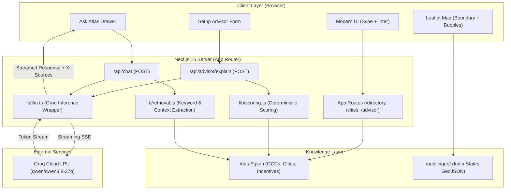

# 🌐 GCC Atlas: India's Global Capability Centre Intelligence Platform

> **A research-grade, single source of truth for India's Global Capability Centre (GCC) ecosystem.**

GCC Atlas empowers enterprises, consultants, and decision-makers to determine *where* and *how* to establish a Global Capability Centre in India. The platform aggregates verified, public data spanning existing GCC profiles, tier-1 and emerging talent markets, Grade-A commercial real estate benchmarks, and state-level incentive policies.

Every metric in GCC Atlas is labeled with an explicit confidence level and source citation. Missing metrics are stored as `null` and displayed honestly as **Not disclosed** — with zero hallucinated headcounts or stale estimates disguised as facts.

---

## ✨ What It Does

GCC Atlas bundles research intelligence, geospatial analysis, decision scoring, and AI into a unified platform:

* **🗂️ GCC Directory**  
  Explore 86 total entities (including 68 captive GCC profiles) across 7 major Indian hubs. Search and filter by industry, parent country, operating city, entity type (`captive_gcc` vs. ecosystem delivery centres), and data confidence level. Every profile links directly to public sources.

* **🏙️ City Explorer & Interactive Map**  
  Visualize the GCC landscape on an interactive Leaflet map featuring custom-pane India state outlines and responsive city markers. Switch between four metric layers:
  * Captive GCC density
  * Grade-A commercial rent (₹/sq ft/month)
  * Experience-based salary ranges (₹ lakh/year)
  * Ecosystem maturity  
  Includes 3-city side-by-side comparison tables, micro-market cluster analysis, GIFT City financial zone indicators, and Recharts visualization charts.

* **🧭 Setup Advisor**  
  A deterministic decision engine for market entry. Input your target industry, planned team size (1–50 up to 1,000+), budget sensitivity, timeline, and custom factor weightings (talent, cost, incentives, ecosystem). Receive a ranked city shortlist with mathematical scoring and streaming AI strategic analysis.

* **💬 Ask Atlas (AI Assistant)**  
  A research assistant accessible on every page via a floating drawer. Ask questions in natural language and receive real-time streaming answers grounded strictly in the platform's dataset — complete with source chips, confidence ratings, and suggested prompts.

* **📊 Methodology & Data Transparency**  
  Complete documentation detailing data collection methods, taxonomy rules, confidence badge definitions (`verified`, `reported`, `estimated`), and catalogued dataset gaps.

---

## 🏗️ Architecture

GCC Atlas is designed around a zero-database, server-rendered static architecture with dynamic server-streamed AI capabilities.



### Architectural Highlights

1. **Presentation Layer**: Built on Next.js 16 with the App Router, React 19, and Tailwind CSS v4 design tokens. Optimized for zero client-side layout shift and low time-to-interactive.
2. **Deterministic Processing**: City rankings and search queries run through mathematical scoring functions (`lib/scoring.ts`) and keyword retrieval (`lib/retrieval.ts`) without unconstrained vector hallucinations.
3. **Server-Side AI Gateway**: API routes (`/api/chat`, `/api/advisor/explain`) invoke the Groq wrapper (`lib/llm.ts`) strictly on the server. Environment variables and keys are never sent to or visible in the client bundle.
4. **Resilient Streaming**: Responses stream over Server-Sent Events (SSE) with built-in retry logic, automatic fallback handling, and server console logging with exact HTTP status codes and Groq response error messages.

---

## 🧠 AI Intelligence & Grounding Engine

The platform integrates AI strictly as an analytical interface over sourced facts:

* **Active Model**: Powered by **`qwen/qwen3.8-27b`** via Groq's high-throughput LPU inference platform, delivering low time-to-first-token and clean conversational reasoning.
* **Strict Grounding Rules**: The system prompt enforces strict constraints — the model may only answer using facts provided in the dynamically retrieved context payload. If the dataset does not contain an answer, it explicitly replies: *"I don't have data on that in the current dataset."*
* **Entity Type Distinction**: The prompt instructs the model that only `captive_gcc` records count as captive centres, preventing confusion with third-party service delivery centres.
* **Source Attribution**: Chat responses return dynamic `X-Sources` response headers, rendering interactive source chips for every cited fact.
* **Graceful Degradation**: If `GROQ_API_KEY` is not configured or Groq experiences rate limits, the system automatically falls back to rule-based computed figures from the dataset.

---

## 🛠️ Tech Stack

| Layer | Technology | Description |
|---|---|---|
| **Framework** | Next.js 16 (App Router) | React 19 server components, Turbopack, partial pre-rendering |
| **Language** | TypeScript 5 | End-to-end type safety across schemas, state, and routes |
| **AI Inference** | Groq Cloud API | `qwen/qwen3.8-27b` running on Groq LPUs |
| **Geospatial** | Leaflet | Custom layered panes (boundary, bubbles, labels) with DataMeet India GeoJSON |
| **Charts** | Recharts | Composable SVG bar, scatter, and distribution charts |
| **Styling** | Tailwind CSS v4 & Vanilla CSS | Curated HSL dark teal design system with glassmorphic cards |
| **Typography** | `next/font` | Syne (display headers), Inter (body UI), JetBrains Mono (data/code) |
| **Data Storage** | Static JSON | Pre-compiled JSON datasets loaded at build time without database overhead |
| **Runtime** | Node.js 20+ / 24 | High-performance server environment |

---

## 📁 Project Structure

```text
gcc-atlas/
├── app/                             # Next.js App Router routes & layouts
│   ├── advisor/                     # Setup Advisor route
│   │   └── page.tsx                 # Advisor page server entry
│   ├── api/                         # Backend API routes
│   │   ├── advisor/explain/route.ts # AI explanation streaming endpoint
│   │   └── chat/route.ts            # Ask Atlas conversational endpoint
│   ├── chat/                        # Legacy chat redirect handler
│   ├── cities/                      # City Explorer route
│   │   └── page.tsx                 # City intelligence views & charts
│   ├── directory/                   # GCC Directory route
│   │   ├── [id]/page.tsx            # Static profile view for each GCC
│   │   └── page.tsx                 # Filterable directory table & cards
│   ├── methodology/                 # Methodology & data disclosure page
│   ├── globals.css                  # Design system tokens, utilities & cards
│   ├── layout.tsx                   # Root layout (Navbar, Footer, FloatingAskAtlas)
│   └── page.tsx                     # Landing home page with headline metrics
│
├── components/                      # Reusable UI component library
│   ├── advisor/                     # Setup Advisor form, sliders & score cards
│   ├── chat/                        # Ask Atlas drawer, floating button & input
│   ├── cities/                      # Leaflet map, city panel, comparison matrix
│   ├── directory/                   # Directory table, search filters & pagination
│   ├── layout/                      # Navbar, Footer & navigation links
│   └── ui/                          # ConfidenceBadge, EntityTypeBadge, SourceLinks
│
├── data/                            # Static intelligence dataset
│   ├── cities.json                  # 7 city profiles: rent, salary, talent, clusters
│   ├── gccs.json                    # 86 entity records (68 captive + 18 ecosystem)
│   └── incentives.json              # State-wise GCC and IT/ITeS policy incentives
│
├── lib/                             # Core utilities & calculation engines
│   ├── data.ts                      # Build-time dataset loaders & aggregators
│   ├── geo.ts                       # Geospatial coordinates & boundary anchors
│   ├── llm.ts                       # Groq client wrapper, model config & error logging
│   ├── retrieval.ts                 # Grounded context retrieval & prompt builder
│   ├── scoring.ts                   # Multi-factor decision scoring algorithm
│   └── types.ts                     # TypeScript definitions for all domain entities
│
├── public/                          # Public static assets
│   └── geo/                         # GeoJSON boundary data for Indian states
│
├── .env.example                     # Environment template (GROQ_API_KEY)
├── package.json                     # Project manifest and scripts
├── tsconfig.json                    # TypeScript configuration
└── README.md                        # Project documentation
```

---

## 🚀 Setup Instructions

### Prerequisites

* **Node.js**: `v20.0.0` or higher (Node 24 recommended)
* **npm**: `v9.0.0` or higher
* **Groq API Key**: Obtain a free API key at [console.groq.com](https://console.groq.com) (required for AI Chat & Advisor explanations; all other directory/map features work without it)

### Quick Start

1. **Clone the repository:**
   ```bash
   git clone https://github.com/PriyanshuRanjan04/GCC-Atlas.git
   cd GCC-Atlas
   ```

2. **Install project dependencies:**
   ```bash
   npm install
   ```

3. **Configure environment variables:**
   ```bash
   cp .env.example .env.local
   ```
   Open `.env.local` in your editor and provide your Groq API key:
   ```env
   GROQ_API_KEY=gsk_your_groq_api_key_here
   ```

4. **Launch the development server:**
   ```bash
   npm run dev
   ```
   Open [http://localhost:3000](http://localhost:3000) in your browser.

5. **Create a production build:**
   ```bash
   npm run build
   npm run start
   ```

---

## 🛡️ Data Principles & Integrity

1. **Every Record is Sourced**: Each GCC profile and city data point contains direct `source_urls` to public corporate filings, news reports, or state policy documents.
2. **Explicit Confidence Levels**: Every metric is badged with an explicit confidence rating:
   * 🟢 `verified`: Confirmed via primary official page or corporate release.
   * 🟡 `reported`: Documented in secondary industry news or reputable press.
   * 🟠 `estimated`: Derived from consultant surveys, benchmark medians, or range averages.
3. **Honest Nulls**: Unknown attributes (headcount, founding year, square footage) remain `null` and render cleanly as **Not disclosed** rather than guessed values.
4. **Strict Entity Classification**: Captive GCCs (`captive_gcc`) are tracked separately from third-party IT service providers and ecosystem delivery centres.
5. **Directional Financial Metrics**: Real estate rental rates and tech salary bands are compiled from secondary benchmarks to serve as directional guidance rather than contracted figures.

---

## 📜 Status & Licence

* **Current Status**: Active prototype. Data represents a curated baseline dataset.
* **Notice**: Figures are gathered from public records and are for research and exploratory planning. Consult official channels before committing capital.
* **Licence**: Private repository — all rights reserved.
